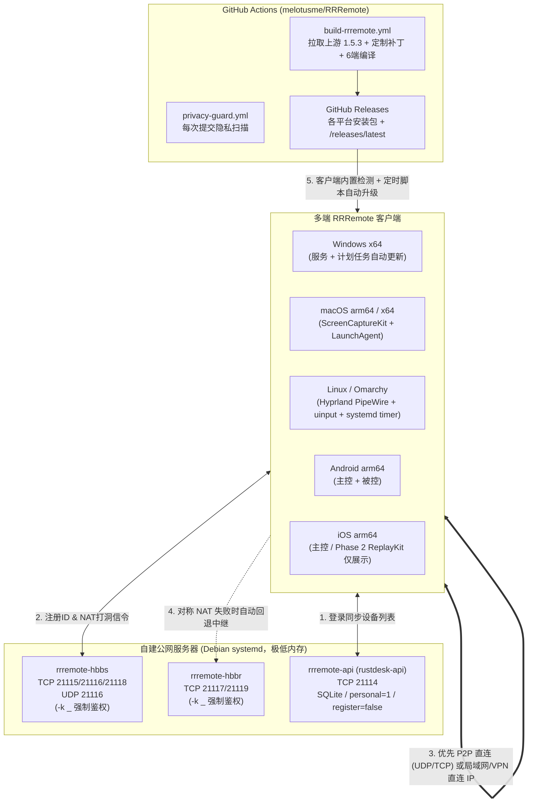
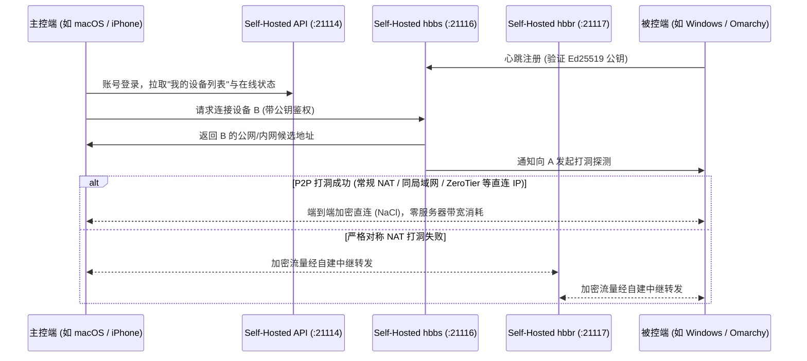

# RRRemote 核心技术方案与实现文档

> 本文档记录 **RRRemote** 的完整架构设计、开源组件选型、关键实现细节、全平台 CI/CD 构建与自动更新机制，以及后续 Phase 2（iOS 仅展示投屏、UI 深度定制）演进路线。
>
> **隐私约定**：本文档及本仓库任何受 Git 跟踪的文件均不包含真实公网/内网 IP、密钥、密码或个人设备清单，所有示例地址均采用 RFC 5737 文档保留网段（如 `203.0.113.10`）。

---

## 1. 目标与设计原则

### 1.1 核心需求
1. **对标 UU 远程核心优势**：高 NAT 打洞成功率、跨全平台、登录即见全部个人设备、连接体验轻量直观。
2. **明确范围取舍**：纯个人免费自用，**去除游戏串流/虚拟手柄等重型外设驱动负担**，聚焦办公/运维/跨设备日常控制。
3. **全平台覆盖**：
   - **桌面端（主控 + 无人值守被控）**：Windows (x64)、macOS (Apple Silicon & Intel)、Linux 与 **Omarchy (Arch + Hyprland / Wayland)**。
   - **移动端**：Android（主控 + 被控）、iOS（Phase 1 主控，Phase 2 补齐 ReplayKit 仅展示被控）。
4. **完全自主可控**：客户端支持随时自定义自建打洞/中继服务器；由 GitHub Actions CI 自动构建全平台安装包，客户端支持自动检查并更新。
5. **优先复用高 Star 开源组件**：避免重复造音视频编解码与跨平台屏幕采集轮子。

### 1.2 三条工程原则
- **Overlay 定制层而非全量 Fork**：本仓库仅维护 RRRemote 自身定制代码、CI 工作流、服务端与部署脚本，构建时由 CI 检出锁定版本的上游源码并应用定制补丁，升级上游版本只需调整一个版本号。
- **Public 仓库 + 零隐私产物**：Public 仓库可享免费无限 GitHub Actions 分钟数（避免 macOS/iOS runner 在 Private 仓库 10x 扣费耗尽额度）；为防止公开 Release 安装包暴露个人服务器，**公开构建不硬编码个人服务器 IP/Key**，而是在设备本地安装时通过配置脚本或客户端 UI 写入。
- **隐私红线自动化拦截**：通过 `.gitignore` + `scripts/privacy-check.py` + `privacy-guard.yml`，每次 Push/PR 自动扫描并阻断任何意外提交的 IP、密钥、Token、密码或邮箱。

---

## 2. 开源技术栈选型

| 层次 | 选用组件 | 角色与选型理由 |
| :--- | :--- | :--- |
| **远控核心与跨平台客户端** | **[rustdesk/rustdesk](https://github.com/rustdesk/rustdesk)** (`v1.5.3`, ~124k+ Stars) | Rust 高性能音视频/网络核心 + Flutter 全平台 UI；原生支持 Windows/macOS(ScreenCaptureKit)/Linux(Wayland PipeWire + uinput)/Android/iOS，内置硬件编解码、文件传输、剪贴板同步与 TCP/UDP NAT 打洞。 |
| **自建打洞与中继服务** | **RustDesk Server (`hbbs` + `hbbr`, `1.1.16`)** | `hbbs` 负责设备 ID 注册与 P2P 打洞协商；`hbbr` 负责对称 NAT 打洞失败时的透明中继。均开启 `-k _` 强制 Ed25519 公钥鉴权，防止公网陌生设备蹭用流量。 |
| **个人设备列表与账号同步** | **[lejianwen/rustdesk-api](https://github.com/lejianwen/rustdesk-api)** (`v2.7`, ~3.2k+ Stars) | Go 单二进制 + SQLite（零外部数据库依赖），开源替代官方 Pro 控制台：提供账号登录、全设备地址簿同步、在线状态、分组管理、Web 客户端，默认关闭公开注册并启用个人模式。 |
| **iOS 仅展示被控（Phase 2）** | **ReplayKit `RPBroadcastUploadExtension` + WebRTC** | 受限于 iOS 系统沙盒，第三方应用无法后台静默截屏；采用系统合规的 Broadcast Upload Extension 经 App Group Unix Socket 传帧给主 App，再经 WebRTC 推流到同一自建服务端供全平台查看。 |

---

## 3. 系统整体架构

### 3.1 拓扑结构



### 3.2 连接与打洞流程



---

## 4. 核心模块实现详解

### 4.1 仓库目录结构

```text
RRRemote/
├── .github/workflows/
│   ├── privacy-guard.yml                        # Push/PR 自动隐私拦截
│   ├── bridge.yml                               # 生成 flutter_rust_bridge (3.22.3 + 3.44.8)
│   ├── third-party-RustDeskTempTopMostWindow.yml # Windows 置顶注入组件构建
│   └── build-rrremote.yml                       # 全平台定制客户端构建与 Release 发布
├── custom/
│   ├── rrremote.env                             # 公开版本参数（上游 Tag、显示名、更新仓库）
│   └── apply_custom.py                          # 上游源码定制脚本（零硬编码密钥）
├── server/
│   ├── install-systemd.sh                       # VPS 原生 systemd 一键部署 hbbs/hbbr/api
│   └── gcp-firewall.sh                          # GCP VPC 防火墙放行脚本
├── scripts/
│   ├── privacy-check.py                         # 仓库隐私红线扫描器
│   ├── configure-client.py                      # 跨平台 RustDesk2.toml 服务器配置写入器
│   ├── install-windows.ps1                      # Windows 安装 + 配置 + 每日计划任务更新
│   ├── install-macos.sh                         # macOS (arm64/x64) 安装 + 配置 + LaunchAgent 更新
│   └── install-linux-omarchy.sh                 # Linux/Omarchy (Hyprland) 安装 + Wayland 调优 + systemd timer
├── docs/
│   ├── ARCHITECTURE_AND_IMPLEMENTATION.md       # 本文档
│   └── ios-screen-share-roadmap.md              # Phase 2 iOS ReplayKit 仅展示方案
└── .gitignore                                   # 严格屏蔽 .local/、.env、*.key、*.pub 等敏感文件
```

### 4.2 自建服务端实现 (`server/install-systemd.sh`)
- **为什么用原生 `systemd` 而非 Docker**：在 2GB 内存且已运行代理服务的轻量云主机上，直接运行 `hbbs`、`hbbr`、`apimain`（Go 单二进制）总常驻内存仅约 40–60 MB，无容器运行时开销，也不干扰宿主机网络栈与现有服务。
- **防白嫖安全策略**：
  - `hbbs -k _` 与 `hbbr -k _` 强制所有客户端校验 `/var/lib/rrremote/server/id_ed25519.pub`，无公钥客户端直接拒绝。
  - `rustdesk-api` 启用 `personal: 1`、`register: false`（禁止外部注册）、自动生成 64 位随机 `jwt.key`，并直接挂载 `/var/lib/rrremote/server/id_ed25519.pub`。
- **端口规划**：
  - `TCP 21114`：`rustdesk-api` HTTP API 与 `/_admin/` 管理后台
  - `TCP 21115, 21116, 21118` & `UDP 21116`：`hbbs`（NAT 类型测试、ID 注册/心跳/打洞、WebSocket）
  - `TCP 21117, 21119`：`hbbr`（中继流量与 WebSocket 中继）

### 4.3 客户端源码定制 (`custom/apply_custom.py` + `custom/apply_ui_polish.py`)
在 GitHub Actions 检出 `rustdesk/rustdesk@1.5.3`（含 `libs/hbb_common` 等子模块）之后、编译之前自动执行，完成四项无侵入定制：

1. **零限流内置自动更新（直连 GitHub `/releases/latest` 重定向）**：
   - 修改 `src/common.rs` 中的 `release_id_from_update_url()`，允许校验 `https://github.com/<owner>/<repo>/releases/tag/<release_id>`，并在 `display_version_from_release_id()` 兼容 `-rrN` 自定义修订后缀。
   - 重写 `do_check_software_update()`，直接请求 `https://github.com/melotusme/RRRemote/releases/latest` 跟随 302 重定向获取最终 Tag URL，彻底绕开匿名 `api.github.com` 60 次/小时 403 限流。
2. **可选编译期默认服务器注入（兼容私有/公开双模式）**：
   - 仅当环境变量 `RR_RENDEZVOUS_SERVER` / `RR_PUB_KEY` / `RR_API_SERVER` 非空时，才替换 `libs/hbb_common/src/config.rs` 中的默认常量；Public 仓库默认留空，防止公开安装包暴露个人私服。
   - **始终保留客户端 UI 中的「设置 -> 网络 -> ID/中继服务器」**，保证用户随时可更换打洞服务器。
3. **工业级 UI 设计系统与多端易用性升级 (`custom/apply_ui_polish.py`)**：
   - **Obsidian Slate（深色）与 Crisp Alabaster（浅色）视觉体系**：修复上游 `ColorThemeExtension.lerp` 5 处插值 bug，统一 `#2563EB` 现代品牌蓝、1px 精细描边与 `8/10/12/14px` 圆角层级，替换土味随机卡片背景色为 8 色精选低饱和工业调色盘。
   - **主控端效率提升（对齐 UU 远程手感）**：桌面设备卡片新增悬浮**一键直连胶囊按钮**（单击即连、保留双击）、升级带柔光晕的 Emerald 在线状态灯（离线采用沉稳石板灰取代刺眼橙黄）、主控远程悬浮工具栏胶囊圆角化（`10px`）、默认开启自适应缩放（`view-style = adaptive`）与实时质量监控（`show-quality-monitor = Y`）。
   - **被控端与自建服务器易用性**：左侧被控栏拓宽至 `228px`、ID/密码全面启用等宽数字排版（`FontFeature.tabularFigures()`）并增加直观的**一键复制 ID 按钮**；彻底移除辣眼芭比粉渐变卡与 `rustdesk.com/pricing` 商业广告链接，替换为克制深蓝磨砂卡与底部状态栏常驻的**「ID/Relay Server」一键直达入口**。
   - **移动端（Android / iOS）细节打磨**：替换刺眼粉色更新栏为品牌蓝圆角提示条并指向本仓库 Release、为远程 ID 输入卡与底部导航栏增加精致 1px 描边与分隔线。
4. **品牌展示名定制**：
   - 替换 Flutter 桌面标题与 Windows Runner 窗口标题为 `RRRemote`，同时保持底层服务名与打包目录结构与上游兼容，避免破坏各平台系统服务注册与安装包脚本。

### 4.4 全平台 GitHub Actions CI/CD (`.github/workflows/build-rrremote.yml`)
基于上游 `1.5.3` 经过验证的依赖矩阵（精确锁定 `vcpkg` commit、Rust `1.75` / macOS `1.81`、Flutter `3.24.5` 与 macOS arm64 专用的 `3.44.9`、NDK `r28c`），裁剪掉冗余平台（Windows Sciter x86、Windows ARM64、Linux ARM64/Flatpak/DRM、商用签名服务与 SBOM），精准保留 6 个构建目标：

| Job | Runner | 产出物 | 适用设备 |
| :--- | :--- | :--- | :--- |
| `generate-bridge` | `ubuntu-22.04` (x2) | Flutter `3.22.3` & `3.44.8` FFI Bridge | 前置依赖 |
| `build-RustDeskTempTopMostWindow` | `windows-2022` | `WindowInjection.dll` | Windows 前置依赖 |
| `build-for-windows-flutter` | `windows-2022` | `rustdesk-1.5.3-x86_64.exe` / `.msi` | Windows 11 x64 |
| `build-for-macOS` (arm64) | `macos-15` | `rustdesk-1.5.3-aarch64.dmg`（启用 ScreenCaptureKit） | Apple Silicon Mac |
| `build-for-macOS` (x64) | `macos-15-intel` | `rustdesk-1.5.3-x86_64.dmg` | Intel Mac |
| `build-rustdesk-linux` | `ubuntu-22.04` | `.deb` / `.rpm` / **Arch `.pkg.tar.zst`** | Omarchy / Arch / Debian |
| `build-rustdesk-android` | `ubuntu-24.04` | `rustdesk-1.5.3-aarch64.apk` | Android 手机/平板 |
| `build-rustdesk-ios` | `macos-latest` | `rrremote-1.5.3-ios-unsigned.ipa` | iPhone / iPad（自签安装） |

> 所有 Release 均以 `prerelease: false` 发布，确保 GitHub `/releases/latest` 接口可直接驱动客户端内置更新与各端自动更新定时器。

### 4.5 跨平台安装、自建服务器配置与自动更新闭环
- **统一配置写入 (`scripts/configure-client.py`)**：
  - 自动定位各系统配置路径（Windows `%APPDATA%\RustDesk\config\RustDesk2.toml` 及 `LocalService` 服务目录、macOS `~/Library/Preferences/com.carriez.RustDesk/RustDesk2.toml`、Linux `~/.config/rustdesk/RustDesk2.toml` 与 `/root/.config/rustdesk/RustDesk2.toml`）。
  - 写入 `rendezvous_server`、`custom-rendezvous-server`、`relay-server`、`key`、`api-server`，并默认开启 `direct-server = 'Y'`（支持局域网或 ZeroTier/EasyTier 虚拟网段直连 IP，获得最低延迟）。
- **Omarchy (Arch + Hyprland / Wayland) 专项适配 (`scripts/install-linux-omarchy.sh`)**：
  - 使用 `pacman -U` 安装原生 `.pkg.tar.zst`（避免 Flatpak 沙盒阻断输入注入）。
  - 在 `~/.config/hypr/xdph.conf` 自动写入 `screencast { allow_token_by_default = true }`，启用 `xdg-desktop-portal-hyprland` restore token，解决 Wayland 每次被控弹窗确认的痛点。
  - 配置 `/etc/udev/rules.d/99-rrremote-uinput.rules` 并将当前用户加入 `input` 组，保障远程键鼠输入注入。
  - 启用 `rustdesk.service` 并同步写入 root 配置，保障无人值守在线。
- **全端静默自动更新**：
  - **Windows**：注册每日 04:00 计划任务 `RRRemote-AutoUpdate`（通过本地 `installed_tag.txt` 对比最新 Release tag，仅在有新版本时静默下载并 `--silent-install`）。
  - **macOS**：注册 `~/Library/LaunchAgents/com.rrremote.autoupdate.plist` 每日自动检查、下载 DMG、替换 `/Applications` 并清除 `com.apple.quarantine`。
  - **Linux / Omarchy**：注册 `systemd --user` 定时器 `rrremote-autoupdate.timer` 每日检查并升级。

### 4.6 隐私红线防线 (`scripts/privacy-check.py`)
扫描 `git ls-files` 下全部文件，自动拦截：
- 非 RFC 5737 / 非 loopback 的 IPv4 地址（含公网 IP 与真实内网段）
- PEM 私钥头、GitHub Token（`ghp_`/`gho_` 等）、GCP 项目 ID、个人 Gmail、高熵 44 字符 Ed25519 公钥、初始管理员密码日志

---

## 5. 排障与性能调优要点

1. **提高打洞成功率与降低延迟**：
   - 同一局域网下已默认开启 `direct-server = 'Y'`，直接输入局域网 IP 即可走千兆内网直连，不经任何公网服务器。
   - 跨公网遇到双端对称 NAT（如部分公司网 + 4G/5G）时，会自动无缝走自建 `hbbr` 中继；如需进一步降低跨网延迟，可叠加 ZeroTier / EasyTier / Tailscale 组网后使用虚拟内网 IP 直连。
2. **macOS 首次被控授权**：
   - 需在「系统设置 -> 隐私与安全性」授予 RRRemote/RustDesk **屏幕录制（Screen Recording）** 与 **辅助功能（Accessibility）** 权限，否则画面黑屏或无法控制键鼠。
3. **Omarchy / Hyprland 首次被控**：
   - 修改 `xdph.conf` 与 `input` 用户组后，建议注销/重登 Hyprland 会话一次，使新组权限与 portal restore token 生效。

---

## 6. 演进路线

- **Phase 1（已完成搭建，CI 首次构建中）**：
  - [x] 新加坡自建 `hbbs` + `hbbr` + `rustdesk-api` 服务端部署与外网端口验收
  - [x] `melotusme/RRRemote` 零隐私仓库与 `Privacy Guard` 自动防护
  - [x] 6 平台 GitHub Actions CI（Windows / macOS arm64 & Intel / Linux & Omarchy / Android / iOS）
  - [x] 全平台一键安装、服务器配置与定时自动更新脚本
  - [ ] 首次 CI 产物发布后，在全部可达桌面设备完成安装与互控验收
- **Phase 2（后续迭代）**：
  - [ ] iOS 被控端仅展示：集成 `RPBroadcastUploadExtension` + App Group Socket + WebRTC 推流与跨端观看页（详见 [ios-screen-share-roadmap.md](ios-screen-share-roadmap.md)）
  - [ ] Flutter 客户端 UI 进一步简化：对齐 UU 远程设备卡片布局、隐藏非必要商业入口
  - [ ] iOS / Android 自动签名工作流（可选通过个人证书 Secrets 输出免重签包）
