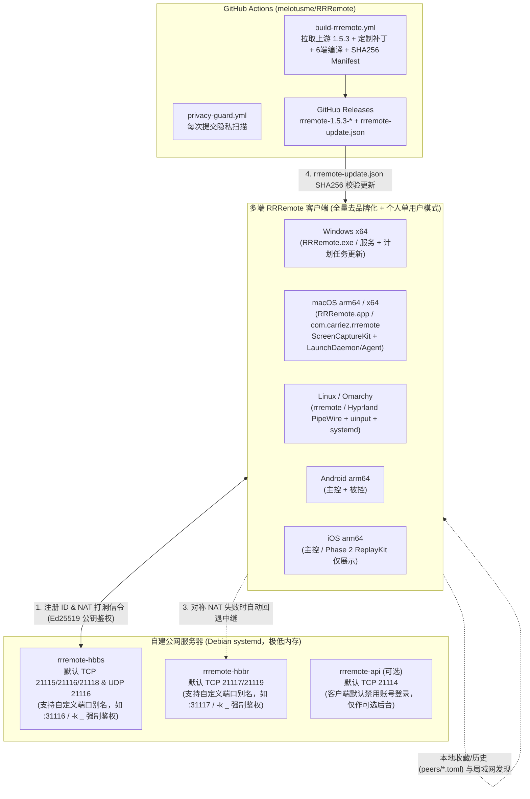
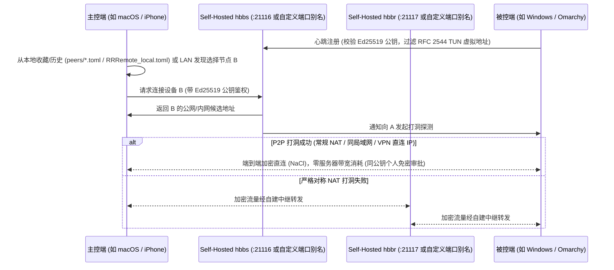

# RRRemote 核心技术方案与实现文档

> 本文档记录 **RRRemote** 的完整架构设计、开源组件选型、关键实现细节、全平台 CI/CD 构建与自动更新机制，以及后续 Phase 2（iOS 仅展示投屏、UI 深度定制）演进路线。
>
> **隐私约定**：本文档及本仓库任何受 Git 跟踪的文件均不包含真实公网/内网 IP、密钥、密码或个人设备清单，所有示例地址均采用 RFC 5737 文档保留网段（如 `203.0.113.10`）。

---

## 1. 目标与设计原则

### 1.1 核心需求
1. **对标 UU 远程核心优势**：高 NAT 打洞成功率、跨全平台、无冗余账号登录负担、个人设备一键直连、连接体验轻量直观。
2. **明确范围取舍**：纯个人免费自用，**去除游戏串流/虚拟手柄与商业多租户/账号体系负担**，聚焦办公/运维/跨设备日常控制。
3. **全平台覆盖**：
   - **桌面端（主控 + 无人值守被控）**：Windows (x64)、macOS (Apple Silicon & Intel)、Linux 与 **Omarchy (Arch + Hyprland / Wayland)**。
   - **移动端**：Android（主控 + 被控）、iOS（Phase 1 主控，Phase 2 补齐 ReplayKit 仅展示被控）。
4. **完全自主可控**：客户端支持随时自定义自建打洞/中继服务器（支持自定义端口别名，如 `203.0.113.10:31116`）；由 GitHub Actions CI 自动构建全平台安装包，支持基于 `rrremote-update.json`（SHA256 校验）的更新检测。
5. **优先复用高 Star 开源组件**：避免重复造音视频编解码与跨平台屏幕采集轮子。

### 1.2 三条工程原则
- **Overlay 定制层而非全量 Fork**：本仓库仅维护 RRRemote 自身定制代码、品牌资源、CI 工作流、服务端与部署脚本，构建时由 CI 检出锁定版本的上游源码并应用定制补丁，升级上游版本只需调整一个版本号。
- **Public 仓库 + 零隐私产物**：Public 仓库可享免费 GitHub Actions 构建；为防止公开 Release 安装包暴露个人服务器，**公开构建不硬编码个人服务器 IP/Key**（`RR_RENDEZVOUS_SERVER` / `RR_PUB_KEY` / `RR_API_SERVER` 默认为空），而是在设备本地安装时通过配置脚本或客户端 UI 写入。
- **隐私红线自动化拦截**：通过 `.gitignore` + `scripts/privacy-check.py` + `privacy-guard.yml`，每次 Push/PR 自动扫描并阻断任何意外提交的 IP、密钥、Token、密码或邮箱。

---

## 2. 开源技术栈选型

| 层次 | 选用组件 | 角色与选型理由 |
| :--- | :--- | :--- |
| **远控核心与跨平台客户端** | **[rustdesk/rustdesk](https://github.com/rustdesk/rustdesk)** (`v1.5.3`) | Rust 高性能音视频/网络核心 + Flutter 全平台 UI；原生支持 Windows / macOS (ScreenCaptureKit) / Linux (Wayland PipeWire + uinput) / Android / iOS，内置硬件/软件编解码、文件传输、剪贴板同步与 TCP/UDP NAT 打洞。 |
| **自建打洞与中继服务** | **RustDesk Server (`hbbs` + `hbbr`, `1.1.16`)** | `hbbs` 负责设备 ID 注册与 P2P 打洞协商；`hbbr` 负责对称 NAT 打洞失败时的透明中继。均开启 `-k _` 强制 Ed25519 公钥鉴权，支持标准端口与自定义端口别名映射。 |
| **可选 Web/管理后端** | **[lejianwen/rustdesk-api](https://github.com/lejianwen/rustdesk-api)** (`v2.7`) | 可选部署于自建 VPS（Go 单二进制 + SQLite）。**注意**：RRRemote 客户端自 `v1.5.3-rr3` 起已在编译期全局关闭账号登录子系统（`is_disable_account -> true`）并禁用隐式 API 回退，日常跨端控制不依赖云端账号登录，直接通过自建 `hbbs`/`hbbr` + 本地收藏/历史节点（`peers/*.toml`、`RRRemote_local.toml`）+ 局域网发现/直连 IP 完成。 |
| **iOS 仅展示被控（Phase 2）** | **ReplayKit `RPBroadcastUploadExtension` + WebRTC** | 受限于 iOS 系统沙盒，第三方应用无法后台静默截屏；采用系统合规的 Broadcast Upload Extension 经 App Group Unix Socket 传帧给主 App，再经 WebRTC 推流到同一自建服务端供全平台查看。 |

---

## 3. 系统整体架构

### 3.1 拓扑结构



### 3.2 连接与打洞流程



---

## 4. 核心模块实现详解

### 4.1 仓库目录结构

```text
RRRemote/
├── .github/workflows/
│   ├── privacy-guard.yml                         # Push/PR 自动隐私拦截
│   ├── bridge.yml                                # 生成 flutter_rust_bridge (3.22.3 + 3.44.8)
│   ├── third-party-RustDeskTempTopMostWindow.yml # Windows 置顶注入组件构建
│   └── build-rrremote.yml                        # 全平台定制客户端构建、签名校验与 Manifest 发布
├── branding/                                     # RRRemote 品牌图标套件 (ICNS / ICO / SVG / Tray)
├── custom/
│   ├── rrremote.env                              # 公开版本参数（上游 Tag、显示名、更新仓库）
│   ├── apply_custom.py                           # 上游源码核心定制脚本（零硬编码密钥）
│   ├── apply_ui_polish.py                        # 个人极简版 UI 定制入口
│   └── ui_patches/                               # 模块化 Flutter UI 补丁集
├── server/
│   ├── install-systemd.sh                        # VPS 原生 systemd 一键部署 hbbs/hbbr/api
│   └── gcp-firewall.sh                           # GCP VPC 防火墙放行脚本
├── scripts/
│   ├── privacy-check.py                          # 仓库隐私红线扫描器
│   ├── configure-client.py                       # 跨平台 RRRemote2.toml 服务器与个人配置写入器
│   ├── generate-update-manifest.py               # 生成 SHA256 校验的 rrremote-update.json
│   ├── install-windows.ps1                       # Windows 安装 + 配置 + 每日计划任务更新
│   ├── install-macos.sh                          # macOS (arm64/x64) 安装 + 签名保持 + 配置 + LaunchAgent
│   └── install-linux-omarchy.sh                  # Linux/Omarchy (Hyprland) 安装 + Wayland 调优 + systemd timer
├── docs/
│   ├── ARCHITECTURE_AND_IMPLEMENTATION.md        # 本文档
│   └── ios-screen-share-roadmap.md               # Phase 2 iOS ReplayKit 仅展示方案
└── .gitignore                                    # 严格屏蔽 .local/、.env、*.key、*.pub 等敏感文件
```

### 4.2 自建服务端实现 (`server/install-systemd.sh`)
- **为什么用原生 `systemd` 而非 Docker**：在轻量云主机上直接运行 `hbbs`、`hbbr`（以及可选的 `apimain`）总常驻内存仅约 40–60 MB，无容器运行时开销，也不干扰宿主机网络栈。
- **防白嫖安全策略**：
  - `hbbs -k _` 与 `hbbr -k _` 强制所有客户端校验 `/var/lib/rrremote/server/id_ed25519.pub`，无公钥客户端直接拒绝。
  - 若启用了 `rustdesk-api`，默认设置 `personal: 1`、`register: false`（禁止外部注册）并自动生成随机 `jwt.key`。
- **端口规划与端口别名**：
  - 默认 `hbbs`：`TCP 21115, 21116, 21118` & `UDP 21116`（NAT 类型测试、ID 注册/心跳/打洞、WebSocket）。
  - 默认 `hbbr`：`TCP 21117, 21119`（中继流量与 WebSocket 中继）。
  - 可选 `rustdesk-api`：`TCP 21114`。
  - **自定义端口别名**：当默认端口被防火墙/运营商策略限制或与其他服务共存时，可在服务端通过端口转发/监听配置自定义端口别名（例如 `203.0.113.10:31116` 对应 ID/打洞、`203.0.113.10:31117` 对应中继），客户端 `RRRemote2.toml` 与 UI 设置均完整支持 `host:port` 格式。

### 4.3 客户端源码定制 (`custom/apply_custom.py` + `custom/apply_ui_polish.py`)
在 GitHub Actions 检出 `rustdesk/rustdesk@1.5.3`（含 `libs/hbb_common` 等子模块）之后、编译之前自动执行，完成五项核心定制：

1. **全栈 RRRemote 品牌化与独立标识**：
   - 将 `hbb_common::config::APP_NAME` 设为 `RRRemote`，Windows 二进制为 `RRRemote.exe`，Linux 包与服务名为 `rrremote` / `rrremote.service`，macOS 应用包为 `RRRemote.app`。
   - **macOS 独立 Bundle ID**：将 `PRODUCT_BUNDLE_IDENTIFIER` 与 `Info.plist` URL 标识统一设为 **`com.carriez.rrremote`**（避免与原版 `RustDesk.app` 的 `com.carriez.rustdesk` 在 LaunchServices / TCC 发生冲突，同时保证 `daemon.plist`/`agent.plist` 中的 `AssociatedBundleIdentifiers` 与 `CFBundleIdentifier` 严格一致），并补充 `NSLocalNetworkUsageDescription` 与 `NSCameraUsageDescription`。
2. **个人单用户无账号架构与本地节点管理**：
   - 全局关闭账号/登录子系统（`is_disable_account() -> true`）并禁用隐式 `api-server` 回退；个人设备通过自建 `hbbs`/`hbbr` 连通、本地 `peers/*.toml` + `RRRemote_local.toml` 管理收藏/历史节点，以及局域网发现 / `direct-server = 'Y'` 直连 IP。
   - **同公钥零密码审批**：在自建私钥鉴权前提下支持个人设备间免二次确认直连。
   - **TUN 虚拟网段（RFC 2544）免疫**：在配置加载、NAT 检测、本地监听与出站拨号层过滤代理工具分配的虚拟 TUN fake-IP，避免污染 `local-ip-addr` 或导致局域网直连失败。
3. **macOS 视频编解码加固**：
   - 针对新版 macOS（26/27+）VideoToolbox RAM 硬件编码不稳定问题，默认在 macOS 关闭 `enable-hwcodec` 并优先使用软件 VP9/AV1，同时保留首帧失败自动回退机制。
4. **零限流 SHA256 校验更新机制**：
   - 更新检测直连 `https://github.com/melotusme/RRRemote/releases/latest` 302 重定向并解析 `rrremote-update.json`（含平台/架构匹配与 SHA256 校验），绕开 `api.github.com` 匿名限流并支持 `-rrN` 修订版本对比。
   - 可选编译期默认服务器注入：仅当 `RR_RENDEZVOUS_SERVER` / `RR_PUB_KEY` / `RR_API_SERVER` 非空时才写入默认常量；Public 仓库默认留空，始终保留「设置 -> 网络 -> ID/中继服务器」本地配置入口。
5. **个人极简 UI 重构 (`custom/apply_ui_polish.py` + `custom/ui_patches/`)**：
   - 去除商业广告、2FA 与多租户入口，突出快速连接栏、收藏/最近/局域网标签页、单点连接胶囊按钮、等宽数字 ID 与一键复制，以及 macOS 权限/后台服务健康横幅。

### 4.4 全平台 GitHub Actions CI/CD (`.github/workflows/build-rrremote.yml`)
基于上游 `1.5.3` 锁定依赖矩阵（`vcpkg` commit、Rust `1.75` / macOS `1.81`、Flutter `3.24.5` 与 macOS arm64 专用 `3.44.9`、NDK `r28c`），保留 6 个构建目标并在构建完成后生成 `rrremote-update.json`：

| Job | Runner | 产出物 | 适用设备 |
| :--- | :--- | :--- | :--- |
| `generate-bridge` (`bridge.yml`) | `ubuntu-22.04` (x2) | Flutter `3.22.3` & `3.44.8` FFI Bridge | 前置依赖（透传 `RR_BUILD_TAG`） |
| `build-RustDeskTempTopMostWindow` | `windows-2022` | `WindowInjection.dll` | Windows 前置依赖 |
| `build-for-windows-flutter` | `windows-2022` | `rrremote-1.5.3-x86_64.exe` / `.msi` | Windows 11 x64 |
| `build-for-macOS` (arm64) | `macos-15` | `rrremote-1.5.3-aarch64.dmg`（启用 ScreenCaptureKit，最低 macOS 12.3） | Apple Silicon Mac |
| `build-for-macOS` (x64) | `macos-15-intel` | `rrremote-1.5.3-x86_64.dmg` | Intel Mac |
| `build-rustdesk-linux` | `ubuntu-22.04` | `rrremote-1.5.3-x86_64.deb` / `.rpm` / **Arch `rrremote-1.5.3-0-x86_64.pkg.tar.zst`** | Omarchy / Arch / Debian |
| `build-rustdesk-android` | `ubuntu-24.04` | `rrremote-1.5.3-aarch64.apk` | Android 手机/平板 |
| `build-rustdesk-ios` | `macos-latest` | `rrremote-1.5.3-ios-unsigned.ipa` | iPhone / iPad（自签安装） |
| `publish-update-manifest` | `ubuntu-latest` | `rrremote-update.json`（SHA256 校验，拒绝空列表或覆盖已有更完整 Manifest） | 全平台更新源 |

#### macOS 打包、代码签名与 Entitlements 机制
- **CI 内部自底向上重签与校验**：上游 `build.py` 在 `flutter build macos --release`（Xcode 签名）之后才将 `target/release/service` 复制进 `RRRemote.app/Contents/MacOS/`，会破坏 Xcode 原有的签名封印。因此在 `create unsigned dmg` 步骤打包 DMG **之前**，CI 会显式调用 `./.github/scripts/sign-macos-app.sh "$APP_BUNDLE" "-" ./flutter/macos/Runner/Release.entitlements`，自底向上签名 `Contents/Frameworks`、`Contents/MacOS/service` 与 `RRRemote.app`（保留 Hardened Runtime 与 `Release.entitlements`，包含 `com.apple.security.cs.allow-jit`、`com.apple.security.device.audio-input`、`com.apple.security.network.client`），并通过 `codesign --verify --deep --strict` 校验后再生成 DMG。
- **Developer ID 正式签名与公证（可选）**：若仓库配置了 `MACOS_P12_BASE64`、`MACOS_P12_PASSWORD`、`MACOS_CODESIGN_IDENTITY`、`MACOS_NOTARIZE_JSON` Secrets，CI 将使用同一自底向上签名流程对 `RRRemote.app` 与 `rrremote-1.5.3.dmg` 进行 Developer ID 签名、时间戳与 Apple Notarization + Staple。
- **本地自签证书（保留 macOS TCC 权限不丢失）**：
  - 未配置 Apple Developer ID 时，CI 发布的 DMG 使用 ad-hoc 签名（`-`）。macOS TCC 会将 ad-hoc 应用的权限绑定到二进制精确的 **CDHash**，因此**每次更新版本都会导致屏幕录制 / 辅助功能 / 输入监控权限静默失效**（系统设置里开关仍显示打开，实际被拒绝）。
  - 个人无 Developer ID 账号时，推荐在本地「钥匙串访问（Keychain Access）」创建一张永久信任的**本地代码签名证书**（Certificate Type: `Code Signing`，例如默认自动识别的 `RRRemote Local Signing`），并在本机通过环境变量 `RR_SIGN_IDENTITY` 或命令行参数 `--sign-identity` 让 `scripts/install-macos.sh` 在安装/更新时以该稳定证书重签 `RRRemote.app`（保留 `Release.entitlements`）。使用固定本地证书签名后，Designated Requirement 绑定于 `identifier "com.carriez.rrremote"` + 证书锚点而非 CDHash，**跨版本更新后 macOS TCC 权限不再重复失效**。

### 4.5 跨平台安装、自建服务器配置与自动更新闭环
- **统一配置写入 (`scripts/configure-client.py`)**：
  - 自动定位各系统 RRRemote 独立配置目录：
    - **Windows**：`%APPDATA%\RRRemote\config\RRRemote2.toml` 及 `LocalService` 服务目录
    - **macOS**：`~/Library/Preferences/com.carriez.RRRemote/RRRemote2.toml`（以及 root 守护进程目录 `/var/root/Library/Preferences/com.carriez.RRRemote/RRRemote2.toml`）
    - **Linux / Omarchy**：`~/.config/rrremote/RRRemote2.toml` 与 `/root/.config/rrremote/RRRemote2.toml`
  - 写入 `rendezvous_server`、`custom-rendezvous-server`、`relay-server`、`key`（支持自定义端口别名如 `203.0.113.10:31116`），默认开启 `direct-server = 'Y'`；同时清理 `RRRemote2.toml` 中遗留的短横线展示键，并将下划线键 **`view_style`**（`adaptive`）与 **`show_quality_monitor`**（`Y`）写入同目录的 **`RRRemote_default.toml`**（`UserDefaultConfig`）。
- **Omarchy (Arch + Hyprland / Wayland) 专项适配 (`scripts/install-linux-omarchy.sh`)**：
  - 使用 `pacman -U` 安装原生 `.pkg.tar.zst`（避免 Flatpak 沙盒阻断输入注入）。
  - 在 `~/.config/hypr/xdph.conf` 自动写入 `screencast { allow_token_by_default = true }`，启用 `xdg-desktop-portal-hyprland` restore token。
  - 配置 `/etc/udev/rules.d/99-rrremote-uinput.rules` 并将当前用户加入 `input` 组，保障远程键鼠输入注入。
  - 启用 `rrremote.service` 并同步写入 root 配置，停用遗留 `rustdesk.service`。
- **全端自动更新**：
  - **Windows**：注册每日计划任务 `RRRemote-AutoUpdate`（通过本地 `installed_tag.txt` 对比最新 Release tag 并安装原生 MSI/EXE）。
  - **macOS**：可选注册 `~/Library/LaunchAgents/com.rrremote.autoupdate.plist` 定时检查 `rrremote-update.json`（SHA256 校验）、替换 `/Applications/RRRemote.app`、按需使用本地代码签名证书保持签名与 Entitlements，并清理 `com.apple.quarantine`。**提示**：若未配置本地稳定代码签名证书或 Developer ID，建议关闭无人值守每日自动替换，改为按需手动升级以避免反复触发 TCC 重授权。
  - **Linux / Omarchy**：注册 `systemd --user` 定时器 `rrremote-autoupdate.timer` 每日检查并升级。

### 4.6 隐私红线防线 (`scripts/privacy-check.py`)
扫描 `git ls-files` 下全部文件，自动拦截：
- 非 RFC 5737 / 非 loopback 的 IPv4 地址（含公网 IP、个人内网段与虚拟代理段）
- PEM 私钥头、GitHub Token（`ghp_`/`gho_` 等）、GCP 项目 ID、个人 Gmail、高熵 44 字符 Ed25519 公钥、初始管理员密码日志

---

## 5. 排障与性能调优要点

1. **提高打洞成功率与降低延迟**：
   - 同一局域网下已默认开启 `direct-server = 'Y'`，直接输入局域网 IP 即可走千兆内网直连，不经任何公网服务器。
   - 若本机运行了 TUN 模式代理，RRRemote 核心已自动屏蔽 RFC 2544 TUN 虚拟地址，防止误绑虚拟网卡导致局域网直连或 NAT 探测失败。
   - 跨公网遇到双端对称 NAT 时自动无缝走自建 `hbbr` 中继；如需进一步降低跨网延迟，可叠加 ZeroTier / EasyTier / Tailscale 组网后使用虚拟内网 IP 直连。
2. **macOS 首次被控与权限排障（必须全部授予 3 项 TCC + 本地网络）**：
   - 在「系统设置 -> 隐私与安全性」为 **RRRemote**（Bundle ID `com.carriez.rrremote`）授予全部三项权限：
     1. **屏幕录制与系统录音（Screen & System Audio Recording）** — 否则远端黑屏或无法采集桌面。
     2. **辅助功能（Accessibility）** — 否则无法远程控制键鼠。
     3. **输入监控（Input Monitoring）** — 否则远程键盘/组合键注入异常或持续弹窗提示。
   - 在 macOS 15+ 首次局域网连接时，允许「本地网络（Local Network）」弹窗授权（依赖 `Info.plist` 中的 `NSLocalNetworkUsageDescription`）。
   - **若出现「已勾选但仍一直提示授权」**：通常是由于旧版 ad-hoc 签名更新改变了 CDHash，或废纸篓/旧目录中残留了同 Bundle ID 应用。请先在系统设置中用 **`-` 号移除**旧的 RRRemote/RustDesk 条目，再重新添加 `/Applications/RRRemote.app` 并完全退出重开；长期方案请配置**本地代码签名证书**（见 4.4 节）以在更新后永久保留 TCC 授权。
   - **后台无人值守服务**：若需开机/锁屏被控，请在应用内触发安装后台守护进程（生成 `/Library/LaunchDaemons/com.carriez.RRRemote_service.plist` 与 `/Library/LaunchAgents/com.carriez.RRRemote_server.plist`）并同步 root 配置目录。
3. **Omarchy / Hyprland 首次被控**：
   - 修改 `xdph.conf` 与 `input` 用户组后，建议注销/重登 Hyprland 会话一次，使新组权限与 portal restore token 生效。

---

## 6. 演进路线

- **Phase 1（核心全端可用与体验加固）**：
  - [x] 自建 `hbbs` + `hbbr` 服务端部署（含自定义端口别名与 `-k _` 公钥鉴权）
  - [x] `melotusme/RRRemote` 零隐私仓库与 `Privacy Guard` 自动防护
  - [x] 6 平台 GitHub Actions CI（Windows / macOS arm64 & Intel / Linux & Omarchy / Android / iOS）与 `rrremote-update.json` SHA256 清单
  - [x] 全栈 RRRemote 去品牌化、macOS 独立 Bundle ID (`com.carriez.rrremote`)、自底向上重签校验与本地代码签名证书防 TCC 失效方案
  - [x] 个人单用户极简 UI 重构（收藏/最近/局域网优先、一键直连、键盘快捷键与清晰 macOS TCC/服务引导）
- **Phase 2（后续迭代）**：
  - [ ] iOS 被控端仅展示：集成 `RPBroadcastUploadExtension` + App Group Socket + WebRTC 推流与跨端观看页（详见 [ios-screen-share-roadmap.md](ios-screen-share-roadmap.md)）
  - [ ] iOS / Android / macOS 正式签名工作流（可选通过个人证书 Secrets 输出免重签包）
